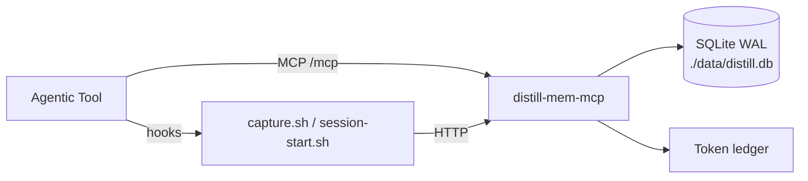
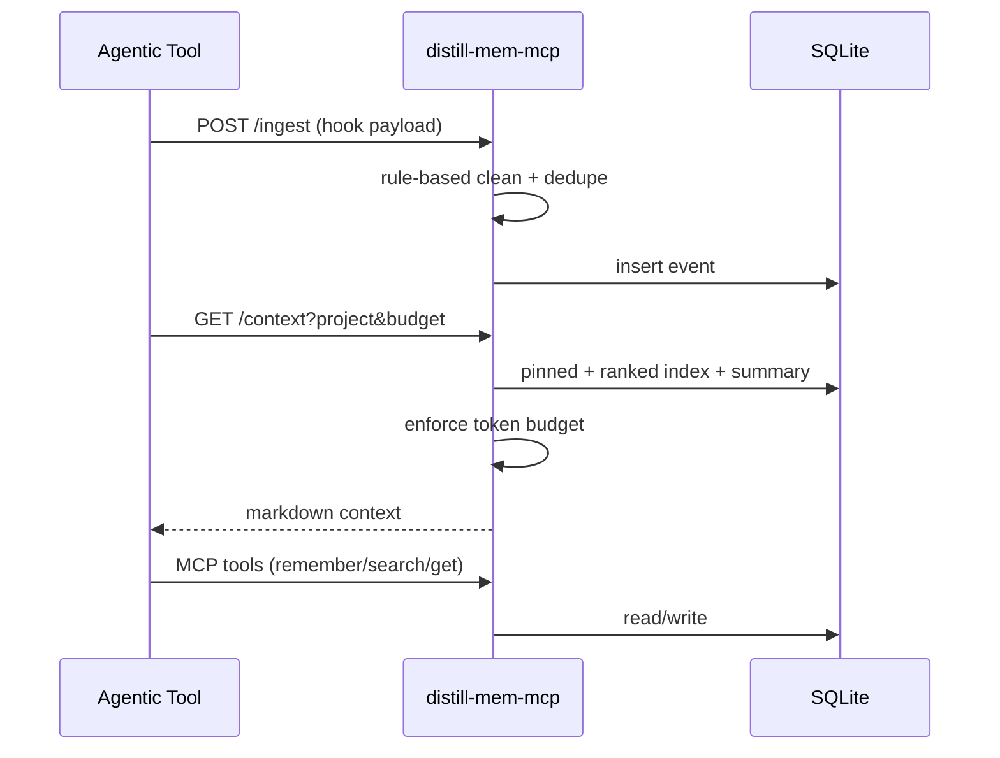

# Architecture

## Overview

## Request flow

## Components

- **Entrypoint** `src/server.ts`: transport selection (http/stdio).
- **MCP tools** `src/mcp/tools.ts`: remember, relate, search, get, supersede, forget, stats.
- **REST** `src/http/routes.ts`: health, ingest, context, stats.
- **DB** `src/db`: schema, migrations, FTS5.
- **Core** `src/core`: capture, retrieve, tokens, decay, consolidate (stub).

## Data flow for memory injection

1. Hooks capture events -> `/ingest` (clean, dedupe, store).
2. Session start -> `/context` builds markdown from pinned facts, ranked entity index, latest summary.
3. Budget enforced by token estimator; truncation by rank.
4. Ledger logs injection tokens.

## Supported agentic tools

Claude Code, OpenCode, and other MCP-compatible clients.